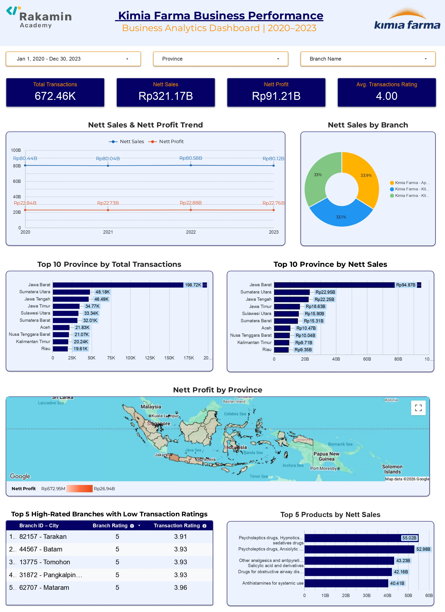

# Kimia Farma Business Performance Analytics

An end-to-end data analytics project analyzing Kimia Farma's business performance using **SQL, Google BigQuery, and Looker Studio**. This project covers data quality assessment, data transformation, business performance analysis, and interactive dashboard development to generate data-driven business insights.

## 1. Background

Business performance analysis helps companies understand sales trends, profitability, regional performance, and customer experience. By integrating transaction data with branch and product information, businesses can obtain a more comprehensive view of their performance and identify areas that may require further evaluation.

This project analyzes Kimia Farma's business data from 2020 to 2023 to examine sales performance, estimated profit, provincial contributions, branch ratings, and product sales performance.

## 2. Project Objectives

- Assess data quality and validate the consistency of source datasets.
- Explore and integrate transaction, branch, and product data using SQL.
- Build an analytical table in Google BigQuery to support business analysis.
- Calculate net sales and estimated net profit based on predefined business rules.
- Analyze sales trends, provincial performance, branch performance, and product contributions.
- Develop an interactive Looker Studio dashboard.
- Generate business insights and recommendations based on the analysis results.

## 3. Tools & Technologies

| Tool | Purpose |
|---|---|
| SQL | Data exploration, quality checks, transformation, integration, and business analysis |
| Google BigQuery | Cloud data warehouse for processing and storing analytical data |
| Looker Studio | Interactive dashboard and data visualization |
| GitHub | Version control, SQL query storage, and project documentation |

## 4. Project Workflow

1. **Data Collection & Import** — Import four source datasets into Google BigQuery.
2. **Data Quality Assessment** — Check data completeness, uniqueness, validity, and referential integrity.
3. **Data Transformation & Integration** — Integrate transaction data with branch and product information.
4. **Business Metrics Calculation** — Calculate net sales and estimated net profit.
5. **SQL Analysis** — Analyze sales trends, provincial performance, branch performance, and product performance.
6. **Dashboard Development** — Visualize business performance using Looker Studio.
7. **Insights & Recommendations** — Interpret the results and propose potential business improvements.

## 5. Dataset Description

The project uses four source datasets provided for the Kimia Farma analytics project.

| Dataset | Description |
|---|---|
| `kf_final_transaction` | Transaction records, including transaction date, branch, product, price, discount, and transaction rating |
| `kf_kantor_cabang` | Branch information, including branch name, city, province, and branch rating |
| `kf_product` | Product information, including product IDs and product names |
| `kf_inventory` | Inventory records containing branch, product, stock, and inventory-related information |

All datasets were imported into the `kimia_farma` dataset in Google BigQuery.

## 6. Analytical Table

The integrated analytical table is stored in:

`kimia_farma.tabel_analisa`

The table combines transaction data with relevant branch and product information and includes derived fields for business performance analysis.

### Key Fields

| Field | Description |
|---|---|
| `transaction_id` | Unique transaction identifier |
| `date` | Transaction date |
| `branch_id` | Branch identifier |
| `branch_name` | Branch name |
| `kota` | Branch city |
| `provinsi` | Branch province |
| `product_id` | Product identifier |
| `product_name` | Product name |
| `actual_price` | Original product price |
| `discount_percentage` | Discount applied to the transaction |
| `persentase_gross_laba` | Gross profit percentage assigned based on the price category |
| `nett_sales` | Sales value after discount |
| `nett_profit` | Estimated profit based on net sales and the assigned gross profit percentage |
| `rating_cabang` | Branch rating |
| `rating_transaksi` | Transaction rating |

*The fields listed above highlight the main analytical attributes and metrics used in the project.*

## 7. Business Metrics Calculation

### 7.1. Gross Profit Percentage

The gross profit percentage is assigned based on the original product price using the following business rules:

| Product Price | Gross Profit Percentage |
|---|---:|
| ≤ Rp50,000 | 10% |
| > Rp50,000 – Rp100,000 | 15% |
| > Rp100,000 – Rp300,000 | 20% |
| > Rp300,000 – Rp500,000 | 25% |
| > Rp500,000 | 30% |

These rules are implemented using a SQL `CASE` expression.

### 7.2. Net Sales

Net sales represent the transaction value after applying the discount.

```sql
nett_sales = actual_price * (1 - discount_percentage)
```

### 7.3. Estimated Net Profit

Estimated net profit is calculated by multiplying net sales by the assigned gross profit percentage.

```sql
nett_profit = nett_sales * persentase_gross_laba
```

**Important:** Net profit in this project is an estimate based on predefined gross profit percentage assumptions. It does not represent actual accounting profit or profit after all operating expenses.

## 8. SQL Analysis

The SQL queries are organized according to their analytical functions.

| SQL File | Purpose |
|---|---|
| `Data Quality.sql` | Evaluates data quality by checking record counts, distinct identifiers, missing values, duplicate transaction IDs, date ranges, referential integrity, and repeated branch-product combinations in inventory records. |
| `Analysis Table.sql` | Creates `kimia_farma.tabel_analisa` by integrating transaction, branch, and product data, then calculating gross profit percentages, net sales, and estimated net profit. |
| `Branch Performance.sql` | Analyzes branch-level business performance by examining sales contributions and comparing performance across branches. |
| `Province Performance.sql` | Evaluates provincial performance by comparing transaction volume, net sales, and estimated net profit to identify leading regions. |
| `Product Performance.sql` | Analyzes product sales contributions and identifies the product categories with the highest net sales. |

## 9. Inventory Data Consideration

The inventory dataset was examined during the data quality assessment. Repeated combinations of `branch_id` and `product_id` were not automatically classified as duplicates because the records could differ in inventory IDs, stock quantities, or dates.

The inventory table was excluded from the transaction-level analytical table because joining it directly using only `branch_id` and `product_id` could create multiple matches for a single transaction. This could multiply transaction records and distort aggregated sales and estimated profit.

Inventory data should only be integrated when a reliable matching key and appropriate record-level logic are available.

## 10. Business Performance Dashboard

The interactive dashboard was developed using **Looker Studio**, with data from the integrated analytical table in Google BigQuery.

### Dashboard Features

- Date, province, and branch filters.
- KPI cards for total transactions, net sales, estimated net profit, and average transaction rating.
- Net sales and estimated net profit trends.
- Provincial performance comparisons.
- Branch sales contribution analysis.
- Estimated profit distribution across provinces.
- Branch rating comparisons.
- Top products by net sales.


## Dashboard Preview



[View Interactive Dashboard on Looker Studio](https://l1nk.dev/es3r3ba)
## 11. Key Business Insights

The following findings are based on the dashboard results for 2020–2023.

### 11.1. Overall Business Performance

- Total transactions reached approximately **672.46K**.
- Net sales reached approximately **Rp321.17 billion**.
- Estimated net profit reached approximately **Rp91.21 billion**.
- Average transaction rating was approximately **4.00**.
- Annual net sales and estimated net profit remained relatively stable across the four-year period.

### 11.2. Provincial Performance

- **West Java (Jawa Barat)** recorded the highest transaction volume, at approximately **198.72K transactions**.
- West Java also led provincial net sales, contributing approximately **Rp94.87 billion**.
- North Sumatra (Sumatera Utara) and Central Java (Jawa Tengah) followed among the leading provinces in both transaction volume and net sales.

### 11.3. Branch Ratings and Customer Experience

- Several branches had a branch rating of **5.00**, while their transaction ratings ranged from approximately **3.91 to 3.96** in the displayed comparison.
- This difference suggests an opportunity to investigate customer feedback and transaction-level experiences at the selected branches.

### 11.4. Product Performance

The five highest-net-sales product categories displayed on the dashboard were:

1. Psycholeptics, hypnotics and sedatives — approximately Rp55.02 billion.
2. Psycholeptics, anxiolytic — approximately Rp52.98 billion.
3. Other analgesics, antipyretics and salicylic acid derivatives — approximately Rp43.23 billion.
4. Drugs for obstructive airway diseases — approximately Rp42.16 billion.
5. Antihistamines for systemic use — approximately Rp40.41 billion.

These figures represent net sales, not unit sales or profit contributions.

## 12. Business Recommendations

### 12.1. Maintain Performance in Leading Provinces

**Finding:** West Java contributes the highest transaction volume and net sales.

**Recommendation:** Evaluate sales patterns, product availability, and distribution requirements in West Java while identifying practices that may be relevant to other provinces.

**Expected Impact:** Support the maintenance of sales performance in leading markets and help identify opportunities for growth in other regions.

### 12.2. Investigate Differences in Branch and Transaction Ratings

**Finding:** Some branches with high branch ratings have comparatively lower transaction ratings in the displayed analysis.

**Recommendation:** Review transaction feedback and customer service processes at the selected branches to identify potential areas for improvement.

**Expected Impact:** Help identify service improvements that may support a better customer experience and transaction ratings.

### 12.3. Monitor High-Net-Sales Product Categories

**Finding:** The leading product categories contribute substantial net sales.

**Recommendation:** Monitor sales trends and product availability for these categories, while reviewing inventory data separately to assess stock requirements.

**Expected Impact:** Support inventory planning and reduce the risk of missed sales opportunities due to product unavailability.

### 12.4. Monitor Sales and Estimated Profit Trends

**Finding:** Annual net sales and estimated net profit were relatively stable from 2020 to 2023.

**Recommendation:** Continue monitoring monthly sales and estimated profit changes to identify emerging trends, unusual fluctuations, and potential growth opportunities.

**Expected Impact:** Provide earlier visibility into performance changes and support more timely business evaluation.

*These recommendations are proposed actions based on observed patterns. Their actual impact would need to be evaluated using further analysis and operational data.*

## 13. Conclusion

This project demonstrates an end-to-end data analytics workflow, from data quality assessment and SQL-based data transformation in Google BigQuery to interactive dashboard development in Looker Studio.

The analysis provides an overview of Kimia Farma's sales, estimated profit, regional performance, branch ratings, and product contributions. The resulting insights can serve as a starting point for further business evaluation and data-driven decision-making.

## 14. Project Deliverables

- **SQL Queries:** Data quality assessment, analytical table creation, and business performance analysis.
- **Google BigQuery:** Source datasets and the integrated analytical table.
- **Looker Studio Dashboard:** Interactive visualization of business performance.
- **Video Presentation:** Summary of the project workflow, findings, and recommendations.

**Video Presentation:** https://acesse.one/jgjxg66
